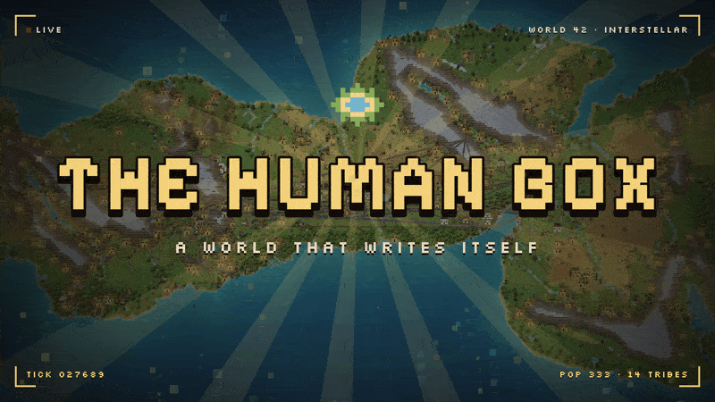

<p align="center">
  <a href="https://thehumanbox.com"></a>
</p>

<h1 align="center">The Human Box</h1>

<p align="center">
  <b>A free civilization sandbox in your browser.</b><br />
  Tribes invent their own languages, cultures and wars, from the stone age to computers.<br />
  Nothing is scripted. Only world laws.
</p>

<p align="center">
  <a href="https://thehumanbox.com"><b>▶ Play now at thehumanbox.com</b></a>
  &nbsp;·&nbsp;
  <a href="https://github.com/1homsi/thehumanbox/releases/latest">Desktop app</a>
  &nbsp;·&nbsp;
  <a href="docs/ARCHITECTURE.md">How it works</a>
</p>

<p align="center">
  <a href="LICENSE"></a>
  
  <a href="https://github.com/1homsi/thehumanbox/releases/latest"></a>
  <a href="https://github.com/1homsi/thehumanbox/stargazers"></a>
</p>

Autonomous people learn, form tribes, develop language, build cities, found
religions, declare wars, sign treaties, invent computers and pass culture across
generations, through 45 eras. Watch, or play god: answer their prayers, reshape
the land, send blessings, plagues and disasters.

The whole simulation is Rust compiled to WebAssembly and runs on your device,
with nothing to sign up for. Every thought, conversation and chronicle is
written by the simulation itself. Your world saves locally and can be exported.

## Structure

```
thehumanbox/
├── apps/
│   ├── web/        React/Vite frontend; the pixel map is drawn with xipjs (WebGL2)
│   ├── desktop/    Electron app that wraps the web client and the native simulation
│   └── server/     Rust WebSocket server around the engine (what the desktop app runs)
├── crates/
│   ├── sim-core/   The simulation engine (native + WebAssembly)
│   └── headless/   Deterministic headless runs: sweeps, perf gate
├── scripts/        Dev and CI helpers, and the published desktop installer
└── docs/           Architecture, development guide, how to add actions, art direction
```

## Working on the code

- [docs/ARCHITECTURE.md](docs/ARCHITECTURE.md): what runs where, how a tick and a decision work, where each kind of change goes.
- [docs/DEVELOPMENT.md](docs/DEVELOPMENT.md): setup, the checks CI runs, profiling and proving a change is behaviour-neutral.
- [docs/ADDING_ACTIONS.md](docs/ADDING_ACTIONS.md): a new action is one file and one line.
- [docs/ART_DIRECTION.md](docs/ART_DIRECTION.md): the rules the map's art follows (one pixel size, light from the top left, an earthy palette).

## Desktop app

macOS one-liner (downloads the latest release and strips the quarantine
flag so the unsigned app opens normally):

```bash
curl -fsSL https://raw.githubusercontent.com/1homsi/thehumanbox/main/scripts/install-desktop.sh | bash
```

Windows + Linux: grab the installer from
[Releases](https://github.com/1homsi/thehumanbox/releases/latest)
— Windows users click "More info → Run anyway" on the SmartScreen
prompt, Linux users `chmod +x` the AppImage or install the `.deb`.

The app is **not code-signed yet**, which is why the bypass step is
needed. Source: [`apps/desktop/`](apps/desktop/).

## Quick start

You need Rust (stable) with `wasm-pack`, and Node 24 with `pnpm`.

**Client** (Vite):
```bash
make install   # pnpm install for web and desktop, cargo fetch
make wasm      # build the simulation to WebAssembly for the browser
make client    # Vite dev server
```
Starts a private WebAssembly world, persists it in the browser, and never
contacts a hosted simulation API.

**Simulation server** (Rust, the one the desktop app bundles):
```bash
cd apps/server
cp .env.example .env        # optional: tick rate, memory limits, CORS, logging
cargo run --release --bin simulation-rs
```
Listens on `ws://0.0.0.0:8000` (`PORT` changes it). `make help` lists every
other target, and [docs/DEVELOPMENT.md](docs/DEVELOPMENT.md) the checks CI runs.

## What's in the world

Humans are born with traits mixed from both parents and learn through
reinforcement. Each inherits a slightly mutated copy of their mother's
Q-table, her vocabulary and her attitudes to other tribes, and then they
get to live.

**The world they live in**

- 800×400 tile grid of ten biomes: grassland, forest, jungle, savanna,
  wetland, desert, badlands, taiga, tundra, volcanic. Elevation, rivers,
  lakes, weather, four seasons.
- 45 historical eras from PreStone through Stone, Bronze, Iron,
  Classical, Medieval, Renaissance, Industrial, Modern, Information,
  and onward to Atomic, Space, Digital, Quantum, Solar, Fusion, Genetic,
  Orbital, Lunar, Martian, Cyber, Neural, Posthuman, Interstellar,
  Singularity, Galactic, Dyson, Kardashev2/3, and sixteen speculative
  endgame eras, from Stellar to Omega and Rebirth. Lineages reach each
  era when their discoveries and the living world's civilization capacity
  cross the threshold; late-era gates scale to the chosen local world
  size so the full ladder remains reachable.
- About 5,000 distinct actions an organism can choose, in over a hundred
  categories: agriculture, seafaring, textiles, distillation, journalism,
  fashion, retail, cafe work, tech_devops, theology, warfare, diplomacy,
  governance, childhood, elder life, and many more. Each gates on real
  preconditions: era, discoveries, age, specialty.
- Real economy. Goods are produced (mash → wash → spirit → aged or
  bottled), traded within and across lineages, and priced per era.
  Barter, then currency that changes with the era (shells and beads,
  coins, florins, dollars, credits and stranger things), banks that pay
  the merchants near them, and governments with treasuries.
- Religions found themselves, split into sects, gain adherents, cross
  milestones, and fade. Followers near their temple feel it. Governments
  form matching the lineage's era, population and literacy: tribal,
  chiefdom, monarchy, theocracy, republic, democracy, federation, empire,
  corporate.
- Cross-lineage contact at borders: trade and knowledge transfer
  flow where two tribes touch, and caravans run trade routes between
  them. Overcrowded lineages spawn breakaway colonies that carry parent
  tech to new biomes.
- Each home is unique. Humans choose their own furniture over their
  lifetime based on era, traits, wealth, and specialty — a brewer
  collects a wine jug, a scholar fills bookshelves, a programmer
  ends up with a monitor and a smart speaker.
- Buildings are not props. Living near a Library raises your
  literacy. Living near a Hospital lowers your infection.
  Apprenticing near a Workshop routes you into the matching trade.

**The minds inside**

What an organism thinks and says is built from its own state: needs,
memories, relationships, the words it has learned. The text is generated by
the simulation itself, so a world reads the same on every machine, offline,
and across a replay of the same seed.

## What you can do

- Play god from the dock along the bottom: about 160 tools in five
  categories (life, nature, resources, deadly, world). Drop people,
  monsters and animals; raise land, change biomes, call the sky and
  miracles; place resources and buildings; send plagues and disasters;
  give whole tribes food and tools, or force them to migrate.
- Set the pace with one time control: pause, or anything from ½× to 5000×.
- Watch the live 2D map and follow anyone. Tap a person for their card:
  story, traits, relations, kin, beliefs, wealth, memories, recent
  thoughts and their own language, with their whole life log and family
  tree a click away.
- Open **civ** for every lineage's government and leader, religion,
  conflicts, diplomacy, buildings, settlements, goods, books, artworks,
  trade network and headlines; read the **chronicles** of the world.
- Click a home to see how its owner has furnished it, or step into a
  tribe's tavern or temple from the civ screen and see who's there.
- Look at the world through 13 map layers: borders, towns, people,
  danger, routes, history, trade, fertile, age, threat, food, wealth and
  moods.
- Photo mode, hide the interface (H), or let the camera follow random
  people. Press ? for every key, and / to find any tool.
- Your world saves in the browser (or on disk in the desktop app), and
  Settings exports it.
